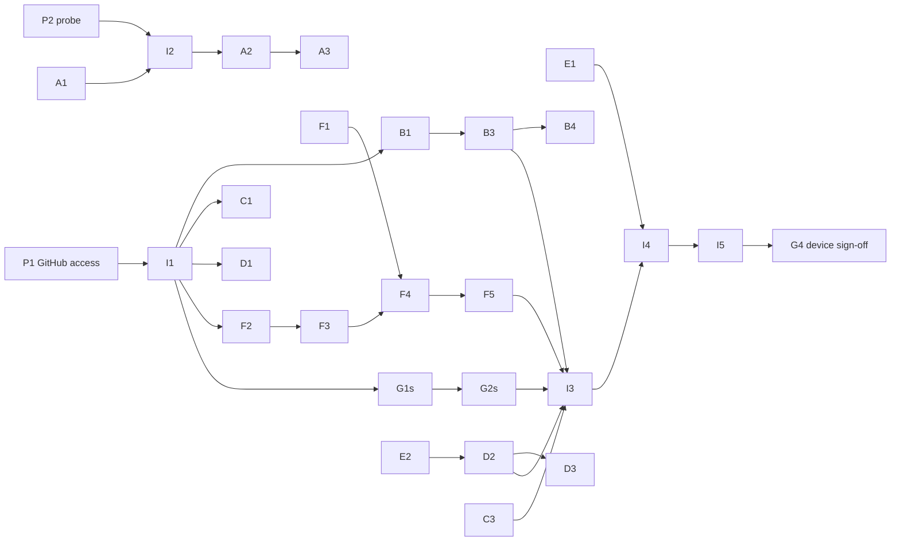

# Field Launcher: Build Plan

A personal Android TV launcher for one Hisense TV, in the andrewevmiller.com field-notebook
design language. This document is the operating plan for building it with a team of
**Sonnet 5.5** and **Haiku 5.5** agents working in parallel, coordinated by one integrator.

- Visual and interaction reference: [`docs/mockup/field-launcher-mockup.html`](mockup/field-launcher-mockup.html)
  (also published at https://claude.ai/artifact/6tfS68Vrs7oQKB1oPWmcXS).
  The mockup's Apps section is the §5.4 grid (task M1, done); it also adds a `grid` icon for the "All apps" tile and six unpinned sample apps so the drawer scrolls.
- Agent rules and file ownership: [`CLAUDE.md`](../CLAUDE.md). **If this plan and `CLAUDE.md` disagree, `CLAUDE.md` wins.**
- Design source: andrewevmiller.com design language (tokens already in `theme/Tokens.kt`)

---

## 1. Goals and non-goals

**Goals**
- Replace the current home screen (the gathin "Wii Menu" launcher) on the owner's Hisense TV with a launcher that looks and behaves like the mockup.
- Dark mode by default, light (parchment) as a setting.
- Apps are shown as a **grid** (4 columns of 192×108dp tiles, wrapping), not a single scrolling carousel row. Spec in §5.4.
- D-pad first: every screen is fully usable with arrows, OK, Back and Home.
- An interface sound system with selectable waveforms and per-app generative launch motifs.
- Two screensaver options: our Oxyfield animation, and Google's own photo screensaver (ambient mode) with your Google Photos albums.
- A safe install loop: one script deploys, one script restores the previous home screen.

**Non-goals**
- Play Store distribution, multiple user profiles, our own content recommendations.
- Replacing system Settings, the input picker, or Google's photo album selection.
- Reading Google Photos directly (the Library API only exposes app-created media since 2025).

---

## 2. Current state

| Item | Status |
|---|---|
| Gradle project, Compose for TV, minSdk 31 / target 34 | Done |
| Theme tokens, bundled fonts (Plex Serif, Plex Mono, Geist), focus style, dot grid | Done |
| Home frame (header, hairline rows, slots), `AppsRepository` interface | Done |
| Interactive mockup with sound engine, motifs, waveforms, screensavers | Done (`docs/mockup/`) |
| Commits pushed to GitHub | Done |
| Device facts | Done: Google TV, Android 12 / API 31, 960×540dp, MediaTek TIF, see `CLAUDE.md` § Target device |
| Compiling in the cloud | **Blocked**: `dl.google.com` not on the environment's allowed domains |

Nothing in `app/` has been compiled yet. Treat the first owner-side `./gradlew installDebug` as a gate (G1 below).

---

## 3. Team and model routing

### 3.1 Roles

| Role | Model | Responsibility |
|---|---|---|
| **Integrator** | Sonnet 5.5 | Owns shared contracts, writes task briefs, launches agents, merges branches, resolves conflicts, runs gates, talks to the owner |
| **Builder agents** | Sonnet 5.5 | Work that needs judgment: Compose UI, focus behavior, DSP, data/persistence, Android system integration |
| **Worker agents** | Haiku 5.5 | Well-specified, mechanical, verifiable work: scripts, icon conversion, ports with golden tests, resource files, docs |
| **Checker agents** | Haiku 5.5 | Read-only review against checklists: design rules, file ownership, contract drift, missing tests |

### 3.2 Routing rules

Send a task to **Haiku 5.5** when all of these hold:
1. The brief can state the exact output (files, signatures, values).
2. Correctness is checkable mechanically (golden vectors, a script, a checklist, a compile).
3. It touches at most two or three files in one owned directory.
4. It needs no design judgment beyond `CLAUDE.md`'s rules.

Otherwise send it to **Sonnet 5.5**. In particular, always use Sonnet for: anything involving Compose focus traversal, audio rendering/mixing, `PackageManager`/`Settings.Secure`/`DreamService` integration, persistence schemas, and merges.

**Escalation.** A Haiku task that fails its acceptance check twice, or that reports an ambiguity it can't resolve from the brief, is re-briefed to Sonnet with the failure output attached. Don't loop a third time on Haiku.

**Checkers never edit.** They return findings; the owning agent or the integrator fixes them.

### 3.3 Claude Code agent definitions

Put these in `.claude/agents/`. Frontmatter `model` uses the aliases `sonnet` and `haiku`.

`.claude/agents/builder.md`
```markdown
---
name: builder
description: Builds one Field Launcher workstream that needs design or Android judgment. Use for Compose UI, focus, DSP, persistence, system integration.
model: sonnet
tools: Read, Write, Edit, Glob, Grep, Bash
---
You are a builder on the Field Launcher project. Read CLAUDE.md and docs/BUILD_PLAN.md first.
Only edit files in the area your brief names. Stable Compose / tv-material APIs only.
Finish with the handoff report from BUILD_PLAN.md §7.3. Never push; the integrator merges.
```

`.claude/agents/worker.md`
```markdown
---
name: worker
description: Does one tightly specified Field Launcher task with a mechanical acceptance check (scripts, ports with golden tests, icon conversion, resources, docs).
model: haiku
tools: Read, Write, Edit, Glob, Grep, Bash
---
You are a worker on the Field Launcher project. Do exactly what the brief says, in the files it names.
If the brief is ambiguous or a check fails twice, stop and report; do not guess.
Finish with the handoff report from BUILD_PLAN.md §7.3.
```

`.claude/agents/checker.md`
```markdown
---
name: checker
description: Read-only review of a Field Launcher branch against the design rules, ownership table and contracts. Reports findings; never edits.
model: haiku
tools: Read, Glob, Grep, Bash
---
Review the diff you are given against CLAUDE.md (design rules, ownership) and the contracts in
BUILD_PLAN.md §5. Report each finding as: file:line, rule broken, suggested fix. Report "clean" if none.
```

---

## 4. Prerequisites (owner actions)

| # | Action | Unblocks |
|---|---|---|
| P1 | Give the Claude GitHub App access to `andrewevmiller-tv-launcher` (claude.ai/connect-github) | Push, branches per agent, history |
| P2 | Run the probe below with the TV connected and paste the output | minSdk, Google TV handling, inputs approach, render resolution |
| P3 | Optional: add `dl.google.com` to the cloud environment's allowed domains | Cloud compile + unit tests + screenshot tests (gate G0 runs without the owner) |
| P4 | Have Android SDK 34 + JDK 17 on the owner's machine | Device gates G1–G4 |

Probe (becomes `scripts/probe.sh` in task A1):
```bash
adb shell getprop ro.product.model
adb shell getprop ro.build.version.release
adb shell getprop ro.build.version.sdk
adb shell pm list packages | grep -iE "launcher|tungsten|hisense|vidaa|livetv|tvinput|dreamx|backdrop"
adb shell cmd package resolve-activity -c android.intent.category.HOME -a android.intent.action.MAIN
adb shell settings get secure screensaver_components
adb shell wm size; adb shell wm density
```

**Probe result (2026-10-21):** Google TV, Android 12 / API 31, 1920×1080 override at density 320,
current default home `com.gathin.tvhome/.WiiMenuActivity`, screensaver
`com.google.android.apps.tv.dreamx/.service.Backdrop`, MediaTek TV Input Framework. Decisions applied:
`minSdk = 31`; launcherx and setupwraith are already disabled; deploy uses `cmd package set-home-activity` and records the previous home, launcher
enabled states and screensaver for rescue; Google photo screensaver = `dreamx/.service.Backdrop`.

**Device facts (resolved)**

| Fact | Value | Consequence |
|---|---|---|
| Platform | Google TV, Android 12, API 31 | `minSdk = 31` (done) |
| Panel / UI | 3840×2160 panel, 1920×1080 override, density 320 | 960×540dp canvas; 1dp = 2px; `FieldDimens` already fits |
| Current default home | `com.gathin.tvhome/.WiiMenuActivity` (third-party) | The TV honors non-Google homes; deploy uses `cmd package set-home-activity` |
| Google launcher | `launcherx` and `tungsten.setupwraith` installed but **disabled** | Deploy leaves them disabled. Rescue and the crash fallback return to the recorded previous home; `rescue.sh --stock` re-enables Google's launcher, and is used automatically if the previous home is uninstalled |
| Screensaver | `com.google.android.apps.tv.dreamx/.service.Backdrop` | Google TV ambient mode = the `GOOGLE_PHOTOS` screensaver option |
| TV inputs | MediaTek TV Input Framework (`com.mediatek.dtv.tvinput.*`) | Input tiles try standard TIF passthrough intents first (B5 verifies on device) |
| Hisense / VIDAA packages | `net.vidaatv.hisense.android.tv`, `com.vt.tv.customerlauncher`, `com.vidaa.oemtabcontentprovider` | Fallback targets for input tiles if TIF intents don't work |

To re-check the launcher state later: `adb shell pm list packages -d | grep -E "launcherx|setupwraith"`.

---

## 5. Architecture and contracts

### 5.1 Module map

```
app/src/main/java/com/andrewevmiller/tvlauncher/
  MainActivity.kt                 Integrator
  theme/                          Integrator   tokens, type, dimens, focus, dot grid, FieldTheme
  home/HomeScreen.kt              Integrator   frame + row slots
  home/ClockHeader.kt             Integrator
  home/data/AppsRepository.kt     Integrator   contract
  home/data/*                     B            repository impl, persistence
  home/apps/                      B            app grid (favorites), all-apps drawer grid, system tiles, edit mode
  ui/components/                  C            chips, feature band, timeline entry, gallery tile
  ui/icons/                       C            line icon set (ImageVector)
  ambient/                        D            Oxyfield DreamService, screensaver switcher
  sound/                          F            FieldSound, synth, renderer, mixer, motifs
  settings/                       G            settings screen + SettingsRepository impl
  safety/                         A            crash-loop fallback
scripts/                          A            probe, deploy, rescue
tools/sound/                      F            desktop preview/render CLI (JVM)
tools/purecheck/                  Integrator   plain-JVM build that compiles + tests all Android-free sources
spike/                            E            standalone test app(s)
```

### 5.2 Contracts the integrator adds in wave 1

These are interfaces only; implementations belong to the owning agent. Agents code against the interface and may use a fake for previews and tests.

```kotlin
// sound/FieldSound.kt (contract file owned by Integrator)
enum class Waveform { SINE, TRIANGLE, SAW, SQUARE, SUPERSAW, WHITE_NOISE, PINK_NOISE }

interface FieldSound {
    fun tick(row: Int)                 // focus moved; implementation handles key-repeat thinning
    fun edge()                         // focus could not move
    fun select()
    fun back()
    fun launch(app: LauncherApp)       // per-app motif
    fun sleep()                        // entering a screensaver
    fun wake()
    fun preview()                      // two ticks, select, a launch motif (used by settings)
}
val LocalFieldSound = staticCompositionLocalOf<FieldSound> { NoOpFieldSound }

// settings/SettingsRepository.kt (contract file owned by Integrator)
enum class Screensaver { OXYFIELD, GOOGLE_PHOTOS }

data class LauncherSettings(
    val darkMode: Boolean = true,
    val reducedMotion: Boolean = false,
    val soundsEnabled: Boolean = true,
    val waveform: Waveform = Waveform.SAW,
    val screensaver: Screensaver = Screensaver.OXYFIELD,
    val dotGridAlpha: Float = 1f,
)
interface SettingsRepository {
    val settings: Flow<LauncherSettings>
    suspend fun update(transform: (LauncherSettings) -> LauncherSettings)
}

// ambient/ScreensaverController.kt (contract file owned by Integrator)
interface ScreensaverController {
    val canSwitch: Boolean             // WRITE_SECURE_SETTINGS granted?
    fun apply(choice: Screensaver)     // writes Settings.Secure screensaver_components
    fun startNow(): Boolean            // false if the device refuses on-demand start
}
```

Per-app motif overrides (re-roll seed, mute) are stored by F alongside its own data, keyed by package name.

**As built (I1).** The contracts above are in the repo with these refinements, all in the same packages:
- `Waveform` is in its own Android-free file (`sound/Waveform.kt`), and `AppCategory` in `home/data/AppCategory.kt`,
  so the pure sound core and `tools/purecheck` can use them. `FieldSound.kt` keeps the interface, `NoOpFieldSound`
  and `LocalFieldSound`.
- `sound/MotifOverrides.kt` adds the interface Settings needs for the per-app motif list:
  `MotifOverrides { overrides: Flow<Map<String, MotifOverride>>; reroll(pkg); setMuted(pkg, Boolean); reset(pkg) }`
  with `MotifOverride(rerollCount, muted)`. F implements it; G consumes it.
- `home/data/LayoutStore.kt` adds `FieldLayout(pinned: List<String>, hidden: Set<String>)` keyed by
  `ComponentName.flattenToString()`, and `LayoutStore { layout: Flow<FieldLayout>; update(transform) }`.
  B2 implements it with DataStore; B1 builds `AppsRepository` on top of it.
- Fakes for previews and tests: `FakeAppsRepository`, `FakeSettingsRepository`, `FakeMotifOverrides`,
  `InMemoryLayoutStore`, `NoOpFieldSound`, `NoOpScreensaverController`.
- `ui/icons/FieldIcons.kt` fixes the icon names (`FieldIcons.Play, Note, Pad, Tool, Wave, Port, Gear, Wifi, Search, Folder, Grid, Points`, plus `forCategory(AppCategory)`) with placeholder bodies, and `FieldIcon(icon, modifier, size, tint)` draws one. C5 fills in the glyphs; everyone else codes against the names now.
- The manifest registers HOME on `.HomeAlias`; see `CLAUDE.md` "Home activity, previous home, and the crash fallback".

### 5.3 Wiring (done by the integrator in wave 3)

`MainActivity` builds the repositories, provides `LocalFieldSound`, reads `LauncherSettings` into `FieldTheme(dark, reducedMotion)`, and passes real rows to `HomeScreen`.

### 5.4 App grid (product decision)

Apps are a grid, not a carousel. Recent, Photos and System tiles stay horizontal rows.

**Geometry.** The canvas is 960×540dp, the safe content width is 864dp. Four 192dp tiles plus three 32dp gaps
fill it exactly, so the grid's edges line up with the hairlines (5 columns would need 1024dp). Constants live in
`FieldDimens`: `appGridColumns = 4`, `appGridColumnGap = 32.dp`, `appGridRowGap = 20.dp`. The tile is the same
192×108 `fieldTile` as before; focus scale-up (1.06) fits inside the gaps.

**Where it appears.**
- Home: an "Apps" section showing the pinned apps as a wrapping grid. The last cell is always an "All apps" tile.
  The section is non-lazy (a `Column` of `Row`s inside one `LazyColumn` item); pinned lists are short.
- Drawer: "All apps" opens a full-screen grid of every non-hidden app (`LazyVerticalGrid`, same columns, same tile).
  Back returns to Home with focus on the "All apps" tile.
- The chips row filters the grid in place, on Home and in the drawer.

**D-pad rules.** Pure function `gridMove(index, count, columns, direction)` returning a `GridMove` of
`Stay(index)`, `Edge`, `ExitUp` or `ExitDown`, unit-tested in `tools/purecheck`:
- ← →: move within the grid row; never wrap; at a row's end return `Edge` (plays `FieldSound.edge()`).
- ↑ ↓: move to the same column in the adjacent grid row; if that row is shorter, land on its last tile.
- ↑ from the first grid row returns `ExitUp` (focus goes to the chips row); ↓ from the last returns `ExitDown`
  (focus goes to the next section).
- Entering the grid from above or below lands on the column nearest the previously focused item.
- `FieldSound.tick(row)` uses the visual row, so each grid row has its own pitch.

**Edit mode** (long-press OK on a tile): the tile lifts. ← → swap with the neighbour, ↑ ↓ move it one grid row
(±`columns` positions, clamped), OK drops it, Back cancels. Pin and Hide are actions on the focused tile.
Reorder is a pure function `reorder(list, from, to)`, unit-tested in `tools/purecheck`.

**Focus survival.** After any list change (pin, unpin, hide, install, uninstall, filter) focus is re-requested on
the tile now at the previous index, clamped to the new size. Each tile owns a `FocusRequester` keyed by index.

---

## 6. Work breakdown

Each task lists model, owner area, inputs, deliverables and the acceptance check that ends it. IDs are referenced in briefs and handoff reports.

### Wave 1: contracts and safety net (parallel)

| ID | Task | Model | Area | Deliverables | Acceptance |
|---|---|---|---|---|---|
| I1 | Add contracts §5.2, `NoOpFieldSound`, fake repos for previews | Sonnet | Integrator | Interfaces + fakes | Compiles (G0/G1); checker C-X1 clean |
| I2 | ~~Apply probe decisions~~ Done: minSdk 31, device facts in §4 and `CLAUDE.md` | Sonnet | Integrator | — | — |
| A1 | `probe.sh`: run the probe, print a summary that names TV type, SDK, launcher packages, screensaver component | Haiku | `scripts/` | Script | Shellcheck clean; owner runs it once |
| A2 | `deploy.sh`: build, install, grant `WRITE_SECURE_SETTINGS`, record previous HOME + launcher enabled states + screensaver to `scripts/.deploy-state`, set our HOME default with `cmd package set-home-activity`, leave Google's launcher as found, `--dry-run` flag | Haiku | `scripts/` | Script | Dry run prints the exact adb commands; owner runs for real in G1 |
| A3 | `rescue.sh`: set HOME back to the previous home recorded by deploy, restore the screensaver component; `--stock` re-enables launcherx + setupwraith instead; if the recorded home is gone, use `--stock` behavior automatically | Haiku | `scripts/` | Script | Owner runs it after G1 and gets the gathin launcher back |
| A4 | Crash-loop fallback: two crashes within 60s of start → hand HOME to the previous home recorded by deploy (gathin launcher; Google's launcher is disabled on this TV) and show a notice on next start | Sonnet | `safety/` | Code + unit test of the counter | Unit test passes; forced-crash test on device in G2 |

Gate **G1** (owner): `./scripts/deploy.sh` → TV shows the placeholder home with correct fonts, dot grid and focus; `./scripts/rescue.sh` brings back the gathin launcher.

### Wave 2: features (parallel, after G1 or at least after I1 merges)

**B: Home core**

| ID | Task | Model | Deliverables | Acceptance |
|---|---|---|---|---|
| B1 | `AppsRepository` impl: query `LEANBACK_LAUNCHER` + `LAUNCHER`, load banner (fallback icon), map category, refresh on package add/remove | Sonnet | `home/data/` | Unit tests with a fake `PackageManager` wrapper; real app list on device |
| B2 | Layout persistence (DataStore): pinned order, hidden set | Haiku | `home/data/` | Round-trip unit tests |
| B3 | App grid + all-apps drawer (§5.4): shared `AppTile` (192×108, icon ~44dp when no banner, `fieldTile` focus), 4-column favorites grid on Home ending in an "All apps" tile, full-screen `LazyVerticalGrid` drawer, 2D D-pad focus rules, launch via `FieldSound.launch` then `startActivity` | Sonnet | `home/apps/` | Matches §5.4; pure grid-navigation function unit-tested in `tools/purecheck`; focus never lost when list changes |
| B4 | Edit mode: long-press OK → move (← → swap neighbour, ↑ ↓ jump one grid row) / pin / hide with D-pad | Sonnet | `home/apps/` | Pure reorder function unit-tested; device check G3 |
| B5 | System tiles: inputs (per probe), Wi-Fi, Search, Settings | Sonnet | `home/apps/` | Each tile opens the right screen on the TV |

**C: Components and icons**

| ID | Task | Model | Deliverables | Acceptance |
|---|---|---|---|---|
| C1 | Chips row with filter callback (filters the app grid in place, on Home and in the drawer) | Sonnet | `ui/components/` | Preview + focus behaves like mockup |
| C2 | Feature band (panel, mono kicker, serif title, CTA that fills accent on focus, small Oxyfield canvas slot) | Sonnet | `ui/components/` | Matches mockup |
| C3 | Timeline entry + collapsible Recent row ("Show recent · N hidden" chip, collapsed by default, collapses on Home) | Sonnet | `ui/components/` | Matches mockup |
| C4 | Gallery tile (±0.8° alternating tilt, straightens on focus, mono caption on focus) | Sonnet | `ui/components/` | Matches mockup |
| C5 | Icon set as `ImageVector`s from the mockup's SVG paths: play, note, pad, tool, wave, port, gear, wifi, search, folder, points. Stroke 1.7 @24dp, round caps/joins | Haiku | `ui/icons/` | Every icon renders in a preview grid; checker confirms stroke/cap values |

**M: Mockup** (docs only; keeps the visual reference in step with the plan)

| ID | Task | Model | Deliverables | Acceptance |
|---|---|---|---|---|
| M1 (done) | Change the mockup's Favorites carousel to the §5.4 grid: 4 columns, 192×108 tiles, "All apps" last cell, 2D arrow-key focus with the §5.4 rules, chips filter the grid; row indices in `select()`/`move()` become key-based so adding grid rows doesn't break the other rows | Haiku (escalate to Sonnet after two failures) | `docs/mockup/` | Scripted Playwright check: arrow keys reproduce the §5.4 cases; no console errors; other rows still work |

**D: Ambient**

| ID | Task | Model | Deliverables | Acceptance |
|---|---|---|---|---|
| D1 | `OxyfieldDreamService`: dot field at 44px/1080p, ripples brightening line→muted→accent, clock bottom-left, frame cap 30fps, reduced-motion still frame | Sonnet | `ambient/` | Owner sets it via `deploy.sh` and sees it on idle |
| D2 | `ScreensaverController` impl: read/write `screensaver_components`, `startNow()` using the method E2 proves works | Sonnet | `ambient/` | Switching in settings changes the actual screensaver |
| D3 | Photos row hand-off: selecting a gallery tile calls `startNow()` with Google's screensaver selected; fallback toast if refused | Haiku | `ambient/` | Device check G3 |

**E: Spikes** (standalone apps in `spike/`, owner runs each once)

| ID | Question | Model | Output |
|---|---|---|---|
| E1 | Can we read Watch Next / preview channels on this TV? Try `TvContractCompat` queries with and without `READ_EPG_DATA`; log row counts | Sonnet | Yes/no + log. If no, Recent row = our own launch history (B adds a log) |
| E2 | Can we start a screensaver on demand? Try `Somnambulator`, `DreamManager`-adjacent intents, and launching the dream package's activity directly | Sonnet | The method that works, or "no" (then D3 just switches the screensaver and shows a hint) |

**F: Sound**

| ID | Task | Model | Deliverables | Acceptance |
|---|---|---|---|---|
| F1 | Motif generator port: FNV-1a, mulberry32, draw order, scale, timing (§8.2) as pure Kotlin | Haiku | `sound/Motif.kt` + tests | All golden vectors in §8.3 pass |
| F2 | Oscillators: PolyBLEP saw and square, triangle, sine, supersaw (7 voices), white and pink noise (Paul Kellet) | Sonnet | `sound/synth/` | Unit tests: frequency within 0.5 cents via zero-crossings; no NaN; pink spectrum slope ≈ −3 dB/oct |
| F3 | Voice chain: wavefold → tanh → bitcrush (4× oversampled), RBJ biquad low-pass with exponential sweep, envelope, noise click, band-pass for noise voices | Sonnet | `sound/synth/` | Renders every sound in §8.1 at 48 kHz; peak ≤ −1 dBFS after master |
| F4 | Renderer + cache: render all fixed sounds and every installed app's motif for the current waveform on a background thread; re-render on waveform change or app install | Sonnet | `sound/` | Cold render of 40 apps < 1.5s on device |
| F5 | Mixer + playback: one low-latency streaming `AudioTrack` (`PERFORMANCE_MODE_LOW_LATENCY`), mixes overlapping one-shots, per-launch humanize as ±5-cent playback-rate change and ±10% gain | Sonnet | `sound/` | Tick latency feels immediate on device (G3); no clicks/pops when sounds overlap |
| F6 | Policy: obey `Settings.System.SOUND_EFFECTS_ENABLED` and our toggle; key-repeat thinning (<90ms apart → thin tick) | Haiku | `sound/` | Unit tests for the throttle |
| F7 | `tools/sound` JVM CLI that renders every sound to WAV for desktop listening, using the same code as the app | Haiku | `tools/sound/` | Produces 7 waveforms × all sounds; owner compares against the mockup |

**G: Settings**

| ID | Task | Model | Deliverables | Acceptance |
|---|---|---|---|---|
| G1s | `SettingsRepository` impl (DataStore) | Haiku | `settings/` | Round-trip tests |
| G2s | Settings screen (D-pad list, design-language styling): Appearance (dark/light, reduced motion, dot brightness slider), Sound (on/off, waveform picker that plays `preview()` on change, per-app motif re-roll/mute list), Screensaver (Oxyfield / Google Photos, "Start now"), About (version, rescue instructions) | Sonnet | `settings/` | Every option takes effect without restarting the launcher |

**Checkers (run on every branch before merge)**

| ID | Check | Model |
|---|---|---|
| C-X1 | Design rules: no hex literals outside `theme/`, accent usage, type from `Field.type`, `fieldFocus` on focusables, safe-area padding | Haiku |
| C-X2 | Ownership: every changed path is inside the agent's area; shared-file requests listed in the report | Haiku |
| C-X3 | Contract drift: calls match §5.2 signatures; no new public API in shared packages | Haiku |

### Wave 3: integration and polish (sequential, integrator)

| ID | Task | Model |
|---|---|---|
| I3 | Merge wave-2 branches in order: F1→F2→F3→F4→F5→F6, B, C, D, G, then wire everything in `MainActivity`/`HomeScreen` | Sonnet |
| I4 | Replace placeholder rows; Recent row source per E1; Photos row per E2 | Sonnet |
| I5 | Performance pass on device: `adb shell dumpsys gfxinfo`, fix jank > 16ms on focus moves | Sonnet |
| I6 | Docs: README install/rescue, settings reference, update this plan's status table | Haiku |

Gate **G4** (owner): full device checklist §10.

---

## 7. Orchestration protocol

### 7.1 Dependency graph



### 7.2 Branches and worktrees
- Each agent runs with `isolation: worktree` on branch `wave<N>/<task-id>-<slug>`, e.g. `wave2/F3-voice-chain`.
- Agents never push. The integrator reviews the handoff, runs checkers, merges into `main`, and pushes.
- Shared files change only through the integrator. Agents put requested changes in their report.
- One agent per area at a time. Two tasks in the same area (e.g. F2 and F3) run sequentially, or the second starts from the first's branch.

### 7.3 Task brief and handoff report

**Brief (integrator → agent)**
```
Task: <ID> <title>
Model: <sonnet|haiku>        Area: <paths you may edit>
Read first: CLAUDE.md, docs/BUILD_PLAN.md §<sections>, <files>
Inputs: <contracts, golden vectors, mockup section, probe facts>
Deliver: <files, signatures>
Acceptance: <exact check>
Out of scope: <list>
```

**Handoff report (agent → integrator)**
```
Task: <ID>   Branch: <name>   Status: done | blocked | partial
Changed files: <list>
Acceptance: <command + result, or why it couldn't run here>
Requested shared changes: <file: change> | none
New dependencies: <coordinate + version + why> | none
Open questions / risks: <list> | none
Device checks for the owner: <steps> | none
```

### 7.4 Gates

| Gate | Who | When | Pass criteria |
|---|---|---|---|
| G0 | Agent / integrator | Every task | `gradle -p tools/purecheck test` green (works in the cloud; compiles and tests every Android-free source), plus checker clean. With P3, also `./gradlew :app:compileDebugKotlin testDebugUnitTest` |
| G1 | Owner | End of wave 1 | Deploy, see placeholder home, rescue works |
| G2 | Owner | Mid wave 2 | Spikes E1/E2 results; forced-crash fallback works |
| G3 | Owner | End of wave 2 (per feature APK) | Feature-specific device checks from handoff reports |
| G4 | Owner | End of wave 3 | Full checklist §10 |

Without P3, the Android/Compose layer is not compiled in the cloud: G0 covers the pure logic through purecheck, the checker reviews the glue, and compile errors in the glue surface at the owner's next gate. Batch owner gates so the owner does one deploy per wave, not one per task.

### 7.5 Running a wave
1. Integrator writes briefs for every task in the wave.
2. Launch all independent tasks at once in the background (builders on Sonnet, workers on Haiku).
3. As each finishes: run checkers C-X1..3 on its branch (Haiku, parallel), fix or bounce findings, merge.
4. After the last merge: one integration build, one owner gate.

---

## 8. Sound specification

The mockup's `sfx` block is the reference implementation. Numbers here are copied from it; if they diverge, the mockup wins and this table gets fixed.

### 8.1 Engine

**Signal chain per voice**
`oscillator(s)` → `sum (1/√voices)` → `shaper` → `low-pass (RBJ biquad, exponential sweep lpFrom→lpTo over dur)` → `envelope` → master

**Shaper** (curve on x ∈ [−1, 1], 4× oversampled):
1. if `fold > 0`: `y = sin(fold · x · π/2)` else `y = x`
2. `y = tanh(k · y) / tanh(k)` where `k = drive × 1.6` (global drive multiplier)
3. if `crush > 0`: `y = round(y · crush) / crush`

**Envelope**: exponential from 0.0001 to `gain` in 3 ms, exponential to 0.0001 at `dur`.

**Voices**: detune spread linear from −1 to +1 across voices × `detune` cents; start jitter 0–2 ms per voice.

**Noise click** (attack transient): white noise → band-pass 3200 Hz, Q 1.2 → gain `click` decaying exponentially to 0.0001 in 12 ms.

**Master**: high-pass 70 Hz → compressor (threshold −20 dB, ratio 6, attack 2 ms, release 120 ms) → ×0.8.

**Defaults**: voices 2, detune 9, lpFrom 7000, lpTo 2500, Q 1.5, drive 6, fold 2.2, crush 0, click 0.

**Waveforms** (user setting, default SAW)

| Setting | Implementation |
|---|---|
| SINE / TRIANGLE / SAW / SQUARE | Single oscillator type per voice; SAW and SQUARE PolyBLEP band-limited |
| SUPERSAW | 7 saw voices, detune = max(detune, 22) cents |
| WHITE_NOISE | Looped white noise → band-pass at note frequency (Q 30, follows glide) → make-up ×24; envelope peak ×1.8 |
| PINK_NOISE | As white, Paul Kellet pink noise, make-up ×36; envelope peak ×1.8 |

**Fixed sounds**

| Sound | Notes / timing | Parameters (omitted = default) |
|---|---|---|
| tick(row) | f = 1320 − 60·row Hz | dur 0.03 (held 0.02), gain 0.02 (held 0.012), voices 1, fold 3, drive 8, lp 9000→3000, click 0.03 (held 0.01). Held = previous tick < 90 ms ago |
| edge | 70→50 Hz glide | dur 0.13, gain 0.06, detune 20, fold 3.5, drive 10, crush 12, lp 1800→300, click 0.02 |
| select | 440 Hz, then 660 Hz at +50 ms | 1st: dur 0.08, gain 0.028, fold 2.5, drive 7, click 0.025. 2nd: dur 0.10, gain 0.026, fold 2.5, drive 7 |
| back | 660 Hz, then 440 Hz at +45 ms | 1st: dur 0.07, gain 0.026, fold 2.5, drive 7, click 0.025. 2nd: dur 0.10, gain 0.028, fold 2.5, drive 7 |
| launch (fallback, unknown app) | 261.6, 329.6, 392, 523.3 Hz at i·45 ms; sub 65.4 Hz | note i: dur 0.28−0.03i, gain 0.024, fold 1.6+0.6i, drive 7, lp (2500+1200i)→6000, Q 3, click 0.035 on i=0. Sub: voices 1, dur 0.3, gain 0.035, fold 1.2, drive 4, lp 600→200 |
| sleep | 110→165 Hz glide | dur 1.7, gain 0.024, detune 25, fold 1.5, drive 5, lp 600→4000, Q 4 |
| wake | 220→330 Hz glide | dur 0.26, gain 0.028, fold 3, drive 8, lp 1500→7000, click 0.02 |
| preview | tick(2) at 0, tick(2) at 110 ms, select at 240 ms, Plex motif at 480 ms | (settings only) |

### 8.2 Per-app launch motifs

**Generation** (deterministic; must match the mockup bit-for-bit):
1. `seed = fnv1a32(packageName)` (offset basis `0x811c9dc5`, prime `0x01000193`, over UTF-16 code units, unsigned 32-bit).
2. `r = mulberry32(seed)`, each call returns a double in [0, 1).
3. Draw order: `count = r() < 0.3 ? 4 : 3`; `deg = floor(r()·5)`; then for each further note `deg += 1 + floor(r()·2)`; then `gap = round(35 + r()·35)` ms; then `hold = r() < 0.5`.
4. Scale A minor pentatonic `[0, 3, 5, 7, 10]` from MIDI 57 (A3): `midi = 57 + SCALE[deg % 5] + 12·floor(deg / 5)`; `f = 440 · 2^((midi − 69)/12)`.
5. If the user re-rolled the app, seed = `fnv1a32(packageName + "#" + rerollCount)`.

**Playback**
- Note i at `i·gap` ms (+0–3 ms jitter); duration 0.11 s, last note 0.24 s if `hold` else 0.10 s; gain 0.026·vel; click on note 0 only.
- Sub: first note's frequency ÷ 4, voices 1, dur 0.26, gain 0.03·vel, fold 0, drive 3, lp 400→150.
- Humanize per launch: cents uniform ±5 (applied as playback rate on the pre-rendered buffer), vel uniform 0.9–1.1.

**Timbre by category**

| Category | Label | voices | detune | drive | fold | crush | lp | Q | click |
|---|---|---|---|---|---|---|---|---|---|
| VIDEO | warm | 2 | 14 | 4 | 0 | 0 | 2400→900 | 2 | 0.015 |
| MUSIC | resonant | 3 | 10 | 5 | 1.3 | 0 | 3200→1100 | 7 | 0.02 |
| GAMES | crushed | 2 | 6 | 8 | 0 | 8 | 7000→3000 | 1.5 | 0.02 |
| TOOLS | clipped | 1 | 0 | 10 | 2 | 0 | 5000→2000 | 1.5 | 0.045 |
| OTHER | plain | 2 | 9 | 6 | 1.5 | 0 | 4000→1500 | 2 | 0.02 |

(Drive values are before the ×1.6 global multiplier.)

### 8.3 Golden vectors (F1 acceptance)

Primitive checks:
- `fnv1a32("") = 0x811c9dc5`, `fnv1a32("a") = 0xe40c292c`
- `mulberry32(1)` first three values: `0.6270739406, 0.0027357212, 0.5274470400`

Motifs:

| Package | Seed | Notes (MIDI) | Gap ms | Hold |
|---|---|---|---|---|
| `com.google.android.youtube.tv` | `aeeb3003` | E4 (64) → A4 (69) → D5 (74) → G5 (79) | 59 | false |
| `com.netflix.ninja` | `cf47f8ae` | A3 (57) → C4 (60) → D4 (62) → E4 (64) | 62 | false |
| `com.plexapp.android` | `b14e01c1` | D4 (62) → E4 (64) → A4 (69) → D5 (74) | 56 | true |
| `com.spotify.tv.android` | `87686563` | E4 (64) → A4 (69) → C5 (72) → D5 (74) | 59 | false |
| `com.aspiro.tidal` | `e3c340c6` | C4 (60) → E4 (64) → A4 (69) | 45 | true |
| `com.limelight` | `ede9906b` | E4 (64) → A4 (69) → C5 (72) → E5 (76) | 48 | false |
| `com.retroarch` | `a899f578` | D4 (62) → E4 (64) → G4 (67) → C5 (72) | 44 | true |
| `com.alphainventor.filemanager` | `1c4fa632` | E4 (64) → A4 (69) → C5 (72) | 60 | false |
| `com.andrewevmiller.analyzer` | `d8b6682d` | C4 (60) → E4 (64) → G4 (67) | 55 | true |

---

## 9. Risk register

| Risk | Likelihood | Impact | Mitigation |
|---|---|---|---|
| Google TV ignores our HOME registration | High if Google TV | Launcher never shows on Home | `deploy.sh` disables launcherx; accessibility-service Home interception as fallback (new task if needed) |
| Disabling launcherx breaks system shortcuts or photo-album settings | Medium | Lost settings access | Pick albums before disabling; `rescue.sh` one command away; About screen documents it |
| Launcher crash on boot leaves a blank screen | Low | Owner stuck | A4 crash-loop fallback + `rescue.sh` over adb |
| Watch Next unreadable (signature permission) | High | Recent row has no "continue watching" | E1 decides early; fall back to our launch history |
| Screensaver can't be started on demand | Medium | Photos tiles only switch the setting | E2 decides; D3 shows a hint instead |
| Audio latency on Hisense SoC | Medium | Ticks feel late | Pre-render + single low-latency `AudioTrack` mixer; measure in G3 |
| Pre-rendering many apps × waveforms is slow | Low | Lag after waveform change | Render only the current waveform; background thread; motifs rendered lazily on first focus if needed |
| Haiku tasks drift from spec | Medium | Rework | Golden vectors and mechanical acceptance checks; escalate to Sonnet after two failures |
| Parallel agents conflict in shared files | Medium | Merge pain | Ownership table, contracts first, integrator-only shared edits, checker C-X2 |
| No cloud compile of `:app` (P3 not done) | Current | Errors found late | `tools/purecheck` compiles and tests all pure logic in the cloud; glue stays thin; checkers review it; batch owner builds per wave; keep APIs conservative |
| Near-black dot grid invisible on the panel | Medium | Texture lost | Dot brightness setting, tuned in G1 |
| Grid focus is lost when tiles scroll out of a lazy grid, or when pin/hide changes the list | Medium | D-pad dead until a key press | Keep grid navigation as a pure function (unit-tested); explicit `FocusRequester` per tile index; re-request focus at the clamped index after list changes; Home grid is non-lazy |
| Home grid grows tall and pushes Recent/Photos/System far down | Medium | Long scroll to reach lower rows | Last cell is "All apps"; pinned apps beyond the Home grid's rows live in the drawer; tune row cap in I5 |

---

## 10. Device test checklist (G4)

**Install and safety**
- [ ] `deploy.sh` from a clean state makes Field Launcher the home screen; Home button returns to it
- [ ] `rescue.sh` restores the previous home (gathin) and screensaver; `rescue.sh --stock` brings back Google TV's home
- [ ] Two forced crashes hand Home back to the previous home and show a notice

**Home**
- [ ] Fonts are Plex Serif / Geist / Plex Mono; dot grid visible but quiet; everything inside the safe area
- [ ] Focus: accent border, scale-up, tilted gallery tiles straighten; never lost after installs/uninstalls
- [ ] Apps are a 4-column grid (not a carousel); the last cell is "All apps", which opens a full-screen grid of every app
- [ ] Grid D-pad: ← → stay in the row (edge thud at the ends), ↑ ↓ keep the column, short last row lands on its last tile, ↑ from the top row reaches the chips, ↓ from the bottom row reaches the next section
- [ ] Favorites: real banners; apps without banners show a large icon; pin, reorder (including ↑ ↓ across grid rows), hide work and persist across reboot
- [ ] Chips filter the grid
- [ ] Recent row collapsed by default, expands, collapses again on Home
- [ ] System tiles open inputs, Wi-Fi, search, settings

**Sound**
- [ ] Every sound plays; ticks thin out when holding the D-pad; edge thud at row ends
- [ ] Each app plays its own motif; Plex sounds the same every launch apart from slight humanizing
- [ ] Waveform setting switches all sounds; preview plays on change; all 7 waveforms audible at similar loudness
- [ ] Sounds off when the system sound-effects setting is off, and when our toggle is off

**Ambient**
- [ ] Oxyfield screensaver runs smoothly; reduced motion shows a still frame
- [ ] Google Photos screensaver can be chosen in settings and shows your albums
- [ ] Selecting a photo tile starts the slideshow (or shows the hint if E2 said no)

**Settings**
- [ ] Every option applies immediately; dark/light switch works without restart

---

## 11. Definition of done

- G4 checklist passes on the owner's TV.
- `main` builds with `./gradlew assembleDebug` and all unit tests pass.
- F1 golden vectors pass; F7 renders all sounds; the owner signs off the sound by ear against the mockup.
- README covers install, rescue, and the one-time permission grant.
- `CLAUDE.md` and this plan reflect what was actually built.
