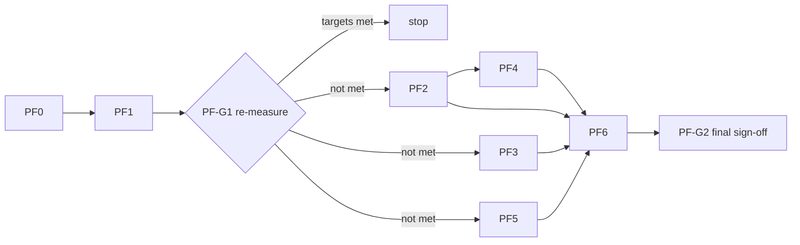

# Field Launcher: Performance Plan

The launcher feels sluggish on the Hisense TV. This plan turns the findings from a code read
(commit `9f5b843`) into ordered, individually shippable work items, each with an exact acceptance
check and a rollback.

- Rules and file ownership: [`CLAUDE.md`](../CLAUDE.md). **If this plan and `CLAUDE.md` disagree, `CLAUDE.md` wins.**
- Task briefs, handoff reports, gates and checkers work as in [`BUILD_PLAN.md`](BUILD_PLAN.md) §7.
- **Nothing here has been measured yet.** The cloud environment can't build or run the app. Every
  cause below is a hypothesis from reading the code until PF0 produces numbers on the TV.

---

## 1. Approach

1. Measure first (PF0). Decide from numbers, not from this document.
2. Fix the cheapest, broadest thing first (PF1: release build). It may remove most of the lag by itself.
3. **Stop rule:** after PF1, re-measure against the targets in §3. If they are met, defer PF2 to PF6
   and keep this plan for later. Do not optimize past the target.
4. One change per branch, re-measured on its own, so a regression has one suspect.
5. Every change keeps the design rules: same focus look, same sound, same layout. Performance work
   must be visually and audibly indistinguishable except for being faster.

## 2. Work items

| ID | Item | Agent | Area (owner) | Depends on | Targets | Size |
|---|---|---|---|---|---|---|
| PF0 | Baseline measurements | owner | none | none | the numbers | S |
| PF1 | Release build, R8, ahead-of-time compile | integrator + worker | `app/build.gradle.kts`, `scripts/` | PF0 | everything (JIT warm-up, debug overhead) | S |
| PF2 | App list cache and event-driven reload | builder | `home/data/` (B), `MainActivity.kt` wiring (integrator) | PF0 | return-to-Home hitch, cold-start blank grid | M |
| PF3 | Focus animation off the composition phase | builder | `theme/Focus.kt` (integrator) | PF0 | D-pad smoothness | S to M |
| PF4 | Bitmap pipeline: right size, hardware bitmaps | builder (same branch as PF2) | `home/data/InstalledApps.kt` (B) | PF2 | drawer scroll, memory | S |
| PF5 | Sound: off the main thread, cached, cheaper DSP | worker (5a, 5b), builder (5c, 5d) | `sound/` (F) | PF0 | CPU contention at launch, tick cost | M |
| PF6 | Small items | integrator + worker | `HomeScreen.kt`, `Type.kt`, `DotGrid.kt`, `MainActivity.kt` (all integrator) | PF1 to PF5 results | minor | S each |



PF2+PF4, PF3 and PF5 touch disjoint areas and can run in parallel. The only shared file is
`MainActivity.kt`; agents list their changes under "Requested shared changes" and the integrator
applies them one at a time.

Branch names (multi-agent flow): `perf/PF1-release-build`, `perf/PF2-app-cache`,
`perf/PF3-focus-draw-phase`, `perf/PF5-sound-offload`, `perf/PF6-polish`. In a single-session run,
commit to the session branch in the same order, one commit per item.

## 3. Targets

Initial targets; adjust once PF0 shows where the device actually is. All measured on the **release**
build with the same app set and the same pinned apps.

| Metric | Target |
|---|---|
| Janky frames over 20 rapid D-pad moves (Home and drawer) | under 5% |
| 95th percentile frame time during those moves | at most 16 ms |
| Frames over 50 ms in the second after returning Home from an app | 0 |
| Cold start to a grid with artwork | under 1 s |
| OK press to start of the launch motif | under 60 ms |
| Slow bitmap uploads while scrolling the full drawer | 0 or near 0 |

---

## PF0: Baseline (owner)

Goal: numbers for debug, for release, and (later) after each item.

**Setup.** Same pinned apps and same installed set every run. Debug and release share an
applicationId and signing key, so one installs over the other without uninstalling.

```bash
./gradlew installDebug      # run set D
./gradlew installRelease    # run set R (release is signed with the debug key already)
PKG=com.andrewevmiller.tvlauncher
```

**1. Focus and scroll smoothness** (Home, then the all-apps drawer)
```bash
adb shell dumpsys gfxinfo $PKG reset
adb shell "input keyevent 22 22 22 22 22 22 22 22 21 21 21 21 21 21 21 21"   # right x8, left x8, back to back
adb shell "input keyevent 20 20 20 20 20 20 19 19 19 19 19 19"                # down x6, up x6
adb shell dumpsys gfxinfo $PKG
```
Record: total frames, janky frames and percent, 50th/90th/95th/99th percentile, slow UI thread,
**slow bitmap uploads**, slow issue draw commands. Repeat inside the drawer (OK on the All apps tile first).
Sending the keys in one call approximates a held D-pad, which is the harsh case.

**2. Cold start**
```bash
adb shell am force-stop $PKG
adb shell am start -W -n $PKG/.MainActivity     # record TotalTime
```
Also note by eye how long until the grid shows banners and icons.

**3. Return to Home after launching an app**
```bash
adb shell dumpsys gfxinfo $PKG reset
# launch any tile with OK (keyevent 23), wait 3 s, then:
adb shell input keyevent 3                       # HOME
sleep 2; adb shell dumpsys gfxinfo $PKG          # janky burst right after HOME?
```

**4. System trace** (one trace of step 3, one of a held D-pad run)
```bash
adb shell perfetto -o /data/misc/perfetto-traces/pf0.pftrace -t 15s -a $PKG \
  sched freq idle am wm gfx view binder_driver input
adb pull /data/misc/perfetto-traces/pf0.pftrace
```
Open in https://ui.perfetto.dev. Look for: long slices on the main thread (font loading, `FieldSound`,
bitmap work), the loader thread competing with RenderThread after HOME, and `Choreographer#doFrame`
slices over 16 ms.

**5. Memory with the drawer fully loaded**
```bash
adb shell dumpsys meminfo $PKG        # Java Heap, Graphics, Total PSS
adb shell "ls /proc/$(pidof $PKG)/fd | wc -l"      # open file descriptors (matters for PF4)
```

**6. Recomposition counts** (debug build only): Android Studio Layout Inspector, recomposition counts
on, move focus across tiles. Note how many times `AppTile` recomposes per focus move (PF3 baseline).

**Deliverable:** fill the results log (§5) column "Debug" and "Release (JIT)".

---

## PF1: Release build, R8, ahead-of-time compile

**Why.** The documented verify loop is `installDebug`. Compose in a debug build has no R8 and is
mostly interpreted or JIT-compiled until it warms up, and a launcher process is often cold. Release
builds also merge the Compose libraries' own baseline profiles.

**Status:** implemented (R8 config, `proguard-rules.pro`, README install and compile steps) but not yet
built or run. Waiting on the owner-side build and the checks under Acceptance. `deploy.sh` still does not
exist on `main`, so its half of step 3 is open.

**Files:** `app/build.gradle.kts` (integrator), new `app/proguard-rules.pro` (integrator),
`scripts/deploy.sh` (agent A; `scripts/` is not in this checkout yet, so until it lands put the
commands in the README install section).

**Steps**
1. In `release { }` set:
   ```kotlin
   isMinifyEnabled = true
   isShrinkResources = true
   proguardFiles(getDefaultProguardFile("proguard-android-optimize.txt"), "proguard-rules.pro")
   ```
   Keep the existing debug signing config.
2. Add `app/proguard-rules.pro` containing only a comment. Nothing in the app is reflective, and the
   Compose and tv-material artifacts ship their own consumer rules. Add rules only if a release
   smoke test crashes, and say why in the file.
3. `deploy.sh` installs the release variant by default (`--debug` flag keeps the old path) and then runs:
   ```bash
   adb shell cmd package compile -f -m speed com.andrewevmiller.tvlauncher
   ```
   Reinstalling resets compilation, so this must run after every install.
4. No new dependencies. `profileinstaller` already arrives transitively through Compose.

**Acceptance**
- `adb shell dumpsys package $PKG | grep -i status=` shows `status=speed` after deploy.
- Release smoke test on the TV: Home renders, fonts load, a tile launches an app, an HDMI tile opens
  its input, Back leaves the drawer. `mapping.txt` exists under `app/build/outputs/mapping/release/`.
- PF0 set R+ recorded. **PF-G1:** compare with the §3 targets. If met, stop here.

**Rollback:** revert the three `release` lines; `installDebug` still works.

**Follow-up (not in scope):** an app-specific baseline profile via Macrobenchmark. Needs a device
workflow; revisit only if `speed` compile alone is not enough.

---

## PF2: App list cache and event-driven reload

**Why.** `MainActivity.onResume` runs `thread { apps = InstalledApps.load(this) }` every time the
launcher resumes (`MainActivity.kt:80-84`). Each run queries the package manager twice, loads every
label, banner and icon from other APKs, and rasterizes each into a fresh bitmap
(`InstalledApps.kt:17-40`). The thread has default priority and nothing cancels overlapping runs. The
new bitmaps are different objects, so every tile recomposes and re-uploads its texture just as the
user lands on Home. On cold start the grid is empty until the whole scan finishes.

**Files:** `home/data/` except `AppsRepository.kt` (agent B). Wiring in `MainActivity.kt` is a
requested shared change (integrator applies).

**Design**
- **Stamp check instead of a scan.** One call to `pm.getInstalledPackages(0)` (suppress the API 33
  deprecation, as `categoryOf` already does) gives each package's `lastUpdateTime` and enabled state.
  Build a signature from the sorted `(package, lastUpdateTime, enabled)` triples. On resume, compute
  it on the loader thread and rescan **only if it differs** from the last one. No broadcast receiver
  is needed, so there is nothing to miss when the Activity is destroyed.
- **Phased load.**
  1. Emit the list from the on-disk snapshot immediately (labels, components, categories, pinned flags).
  2. Reconcile in the background (signature check, then rescan only changed packages).
  3. Fill artwork pinned-first, then the rest, emitting in batches of about 8.
  `LauncherApp.artwork` is already documented as null while loading.
- **Keep object identity.** Cache `ImageBitmap` per `package:lastUpdateTime` in memory (an `LruCache`).
  A rescan reuses the same instances for unchanged apps, so `LauncherApp` equality holds and Compose
  skips their tiles.
- **Disk snapshot.** `filesDir/apps.json` (via `org.json`, no new dependency) for the list, and
  `cacheDir/art/<package>-<lastUpdateTime>.png` for artwork. Delete art files whose stamp no longer matches.
- **Threading.** One background-priority single-thread dispatcher (or executor). A new load cancels the
  previous one (generation counter checked between apps). Replace `thread {}` in `onResume`.
- Wrap scan and artwork phases in `android.os.Trace.beginSection` so they show up in Perfetto.

**Steps**
1. Add `AppStamp(pkg, lastUpdateTime, enabled)` plus a pure `signature(List<AppStamp>)` function.
2. Add snapshot read/write with a version field; a version mismatch means "ignore snapshot".
3. Split `InstalledApps.load` into `scan()` (list without artwork) and `loadArtwork(app)`.
4. Add the loader (cancel, priority, batching) behind one function the Activity can call.
5. Requested shared change for `MainActivity.kt`: call the loader from `onResume`; show the snapshot
   result in `onCreate`.

**Acceptance**
- JVM unit tests (`testDebugUnitTest`): signature is order-independent and changes when any stamp
  changes; snapshot round trip; version mismatch is ignored; stale-art cleanup picks the right files.
- Device: return Home with no package changes. Logcat shows "scan skipped" and gfxinfo shows no jank
  burst in the next second (PF0 step 3).
- Device: `adb shell pm disable-user --user 0 <an app you don't mind toggling>`, return Home, tile is
  gone within about 2 s. `pm enable` brings it back.
- Device: `am force-stop`, then `am start -W`. The grid shows banners from the snapshot before the
  background reconcile finishes (compare with PF0 step 2).
- Two quick resumes in a row produce one scan, not two overlapping ones.

**Rollback:** the loader sits behind one call; restoring the old `thread { load }` is a one-line revert.

---

## PF3: Focus animation off the composition phase

**Why.** In `fieldFocus` the animated value `t` is read in the composition body, in the
`border(width = lerp(…t), color = lerp(…t))` arguments (`Focus.kt:56-60`). Every frame of the 160 ms
tween then recomposes the host tile (`AppTile`, `ChipPill`, …), for both the tile losing focus and
the one gaining it. Only the `graphicsLayer {}` block reads `t` in the right phase. Both
`fieldFocus` and `fieldTile` also use `composed`, which allocates per use and defeats modifier skipping.

**Files:** `theme/Focus.kt` (integrator). Public signatures of `fieldFocus` and `fieldTile` do not change.

**Steps**
1. **Minimal change.** Keep the animation as `val t = animateFloatAsState(...)` (a `State<Float>`, no
   `by` delegate). Read `t.value` only inside `graphicsLayer { }` and a `drawWithContent { }` that calls
   `drawContent()` and then draws the border with `drawOutline` using an inset `Stroke` of
   `lerp(1.dp, 3.dp, t)` and `lerp(line, accent, t)`. Compose's own `border` draws inside the bounds, so
   inset by half the stroke to match exactly. Colors still come from `LocalFieldColors`.
2. Keep behaviour identical: tick on focus gain, `snap()` when reduced motion is on, rest tilt
   straightening, scale 1.06, border drawn above the content and outside the tile's `clip`.
3. **If Layout Inspector still shows recomposition from `composed`**, convert to a `Modifier.Node`
   (focus event, draw, and layer scale/rotation in one node; progress held in an `Animatable`). Do this
   only if step 1 does not reach the §3 targets.

**Acceptance**
- Layout Inspector (debug build): a focus move recomposes each affected tile at most 2 times, down from
  about 10 (PF0 step 6).
- gfxinfo comparison on Home and the drawer (PF0 step 1) is no worse and ideally better.
- Visual parity: `adb exec-out screencap -p` of a focused and an unfocused tile before and after.
  Same border width and color at rest and at focus, same scale, same shape.
- Design checker C-X1: no hex literals, accent only on the focused element, only `fieldFocus`/`fieldTile`.

**Rollback:** `git revert` of the single commit.

---

## PF4: Bitmap pipeline (ships with PF2)

**Why.** Icons are rasterized at 192×192 (about 144 KB each) but drawn at 44dp, which is 88 px at
density 320 (`InstalledApps.kt:43-44`, `HomeScreen.kt:168`): roughly 4.7× too many pixels, scaled down
without mipmaps. Software bitmaps are also uploaded to the GPU on the first frame that draws them, on
the render thread, which is when scrolling the drawer stutters. Banners at 384×216 are already the
right size.

**Files:** `home/data/InstalledApps.kt` (agent B), same branch as PF2.

**Steps**
1. Rasterize icons at 96×96 (88 px displayed, plus headroom for the 1.06 focus scale). Banners unchanged.
2. Write the PNG to the disk cache (PF2) **from the software bitmap first**.
3. Then `bitmap.copy(Bitmap.Config.HARDWARE, false)` on the loader thread and recycle the software copy.
   If `copy` returns null, keep the software bitmap. This moves the texture upload off the first draw.
4. **File descriptor guard.** Each hardware bitmap holds native handles. Count open descriptors with
   the drawer fully loaded (PF0 step 5). If the count approaches a few hundred, keep hardware bitmaps
   for pinned apps only and software bitmaps for the rest.
5. Log `allocationByteCount` totals in debug builds.

**Acceptance**
- gfxinfo while scrolling the full drawer: slow bitmap uploads drop to 0 or near 0 (PF0 step 1).
- `dumpsys meminfo` Java Heap and Graphics reported before and after; no regression in total PSS.
- Visual parity of icons at rest and focused; no shimmer at 96 px.
- Open descriptor count recorded in the handoff report.

**Rollback:** keep the old `toBitmap` behind a constant while testing; revert is one commit.

---

## PF5: Sound

All of this stays inside `sound/` (agent F). The motif generator (FNV-1a, mulberry32, draw order,
scale, timing) is **not touched**, so the auditioned motifs do not change.

### 5a. Tick path and policy (worker)

**Why.** `tick()` runs on the main thread inside `onFocusChanged`. It reads
`Settings.System.getInt` and calls `SoundPool.play` in the same frame as the focus change
(`Focus.kt:46-48`, `FieldSound.kt:66-96`). The guard at `FieldSound.kt:74` can never fire because
`lastTick = now` runs on the line before it, so held-key repeats are never throttled.

**Steps**
1. Extract the throttle into a small pure class and fix the semantics: the existing `< 90 ms` rule
   chooses `tick_held`; add a hard floor (skip when under about 35 ms since the last tick, which also
   absorbs duplicate callbacks).
2. Cache `allowed()` in a `@Volatile` field kept current by a `ContentObserver` on
   `Settings.System.getUriFor(SOUND_EFFECTS_ENABLED)`; register in `init`, unregister in `release()`.
3. Post `pool.play` to a single-thread playback executor so the UI thread only enqueues.
4. `Trace.beginSection("FieldSound.tick")` around the enqueue.

**Acceptance:** JVM unit tests for the throttle (floor, held threshold, first tick). Perfetto: the
`FieldSound.tick` slice on the main thread is under 1 ms.

### 5b. Cache the fixed sound set (worker)

**Why.** `renderFixedSet` re-renders and rewrites five WAVs on every Activity creation, on a
normal-priority thread, during first composition (`FieldSound.kt:55-58`, `118-143`).

**Steps**
1. Name files `fs_<name>_<waveform>_v<RENDER_VERSION>.wav`. Bump `RENDER_VERSION` whenever DSP changes.
2. If the file exists, load it into `SoundPool` and skip rendering; otherwise render, write, load.
3. Delete cached files for other waveforms or older versions.
4. Run rendering on a background-priority executor, separate from the playback executor in 5a.

**Acceptance:** unit test for file naming and stale cleanup. Device: second launch of the app renders
nothing (logcat), ticks still play on the first focus move.

### 5c. Cheaper DSP (builder)

**Why.** The inner sample loop in `render` calls `pow`, `sin`, `cos` for values that do not change per
sample: the detune ratio (`FieldSound.kt:251`), `qLin` (`262`), the filter coefficients (`263-267`), the
envelope (`268-269`) and the click-filter coefficients (`273-277`). A 4-note motif is roughly 40,000
voice-samples at up to ten transcendental calls each. This runs on the worker at the exact moment an app is
starting, delaying the sound and taking CPU from the app.

**Steps**
1. **Parity harness first.** Make phases and noise deterministic by injecting a `Random` (tests only;
   production keeps `Math.random()`), and keep the current implementation as a test-only
   `renderReference`. Moving the pure DSP (`Voice`, `Biquad`, `render`) into `sound/synth/`, as
   BUILD_PLAN F2/F3 already plan, lets it run as a plain JVM test without the Android SDK.
2. Hoist per-voice constants: detune ratios, `qLin`, `norm`.
3. Update low-pass coefficients every 16 samples (about 0.3 ms at 48 kHz) instead of every sample. The
   cutoff sweep is smooth, so this is inaudible.
4. Replace per-sample envelope `pow` with a per-sample multiply by a precomputed ratio; handle the
   attack-to-decay switch at 3 ms explicitly.
5. Hoist the noise-click coefficients and decay.
6. Replace `% 1.0` on phases with a compare-and-subtract.

**Acceptance**
- Parity test: for every category timbre and every waveform, `max |new − reference|` is under 1e-3 of
  full scale (tighten if it passes easily) with the same seed.
- Device: logged `render` time for a motif drops by at least 5× (log with `System.nanoTime`, compare debug
  and release). A/B listening against the previous APK for a few apps and all waveforms; no audible change.
- Checker C-X3: generator signatures untouched.

### 5d. Pre-render motifs (builder; aligns with BUILD_PLAN F4/F5)

**Why.** Even a cheaper render is work at the worst time. Render ahead of time instead.

**Steps**
1. After the app list settles (PF2), render motifs for pinned apps one at a time on the background
   executor, yielding between apps. Cache PCM in an `LruCache` keyed
   `(package, rerollCount, waveform, RENDER_VERSION)`. Humanize is **not** part of the key.
2. `launch(app)`: on a cache hit, play immediately; on a miss, render, play, and cache.
3. Apply humanize at playback: ±5 cents as `PlaybackParams.setPitch(2^(cents/1200))`, ±10% level as
   track volume. This matches BUILD_PLAN §8.2 ("applied as playback rate on the pre-rendered buffer").
4. Re-render and clear the cache when the waveform setting changes (already required by `CLAUDE.md`).
5. Stretch: one long-lived streaming low-latency `AudioTrack` instead of a new static track per launch
   (BUILD_PLAN F5). Only if track creation shows up in the trace.

**Acceptance:** cache hit/miss unit tests (key includes waveform and reroll, excludes humanize). Device:
OK press to audible launch motif under 60 ms for a pre-rendered app (log from `launch()` entry to
`track.play()`, then confirm by ear); no pop or click at the start; Perfetto shows no render slice
overlapping an app launch.

**Rollback (all of PF5):** each sub-item is its own commit.

---

## PF6: Small items

Do these only if the PF0 and post-PF5 traces show them mattering. Each is independent.

| ID | Change | Where | Do it when | Acceptance |
|---|---|---|---|---|
| 6a | Wrap the derived `apps`, `cells`, `gridRows` in `remember(allApps, chip, drawer)` | `HomeScreen.kt:73-77` | always (trivial) | Layout Inspector: `HomeScreen` body does not rerun on focus moves |
| 6b | Preload fonts off the main thread at startup: `createFontFamilyResolver(context).preload(...)` for the four families, launched before `setContent` | `MainActivity.kt` | the trace shows font loading on the main thread during first composition | no font-load slice on the main thread in the first-composition trace |
| 6c | Render the dot grid as one tiled `ImageShader` fill instead of about 780 round points; fall back to the current path when the cell size in px is not an integer | `theme/DotGrid.kt` | the draw slice is over 1 ms per frame while scrolling | pixel-identical screenshot; slice time drops |
| 6d | Clear the window background after the first frame (`window.setBackgroundDrawable(null)`), since the root `Box` already paints `bg` | `MainActivity.kt` | overdraw check shows two full-screen fills | `adb shell setprop debug.hwui.overdraw show`; no cold-start flash |
| 6e | Move the inline `Field.type.x.copy(fontSize = …)` styles into named entries on `FieldType` (`tileTitle`, `tileCaption`, `sectionLabel`, `chip`) | `theme/Type.kt`, `HomeScreen.kt`, `ClockHeader.kt` | after PF3; also tightens the "type only from `Field.type`" rule | identical rendering; no allocation in tile composables |
| 6f | StrictMode in debuggable builds: thread policy for disk and network on the main thread, `penaltyLog()` only. Check `applicationInfo.flags and FLAG_DEBUGGABLE`; AGP 8 does not generate `BuildConfig` by default | `MainActivity.kt` | always (debug only) | no `StrictMode` violations in logcat during Home, drawer and launch |

---

## 4. Process per item

1. Integrator writes the brief (BUILD_PLAN §7.3 format), including the files in scope, the PF0 numbers
   to beat, and the acceptance block above.
2. The agent works in its own area, runs the JVM tests it can, and files the handoff report. Shared
   file changes go under "Requested shared changes".
3. Checkers C-X1, C-X2 and C-X3 run on the branch before merge. For PF3 and PF6e, C-X1 is the main one.
4. The integrator merges one item at a time and the owner deploys the **release** build and re-runs only
   the affected PF0 steps.
5. Results go in the log below. An item that does not move its metric is dropped, not kept for tidiness.

Gate summary: **PF-G1** after PF1 (stop rule). **PF-G2** after the last merged item: the full PF0 set
plus the `BUILD_PLAN.md` §10 checklist items for focus, launch, drawer, sound and rescue.

## 5. Results log

Fill in as items land. "n/a" means not measured at that stage.

| Metric | Debug | Release (JIT) | After PF1 | After PF2+4 | After PF3 | After PF5 | Final |
|---|---|---|---|---|---|---|---|
| Janky frames, Home (%) | | | | | | | |
| 95th percentile frame (ms), Home | | | | | | | |
| Janky frames, drawer (%) | | | | | | | |
| Slow bitmap uploads, drawer | | | | | | | |
| Cold start `TotalTime` (ms) | | | | | | | |
| Janky frames in the second after HOME | | | | | | | |
| Launch motif latency (ms) | | | | | | | |
| `AppTile` recompositions per focus move | | | | | | | |
| Java heap / Graphics (MB) | | | | | | | |
| Open file descriptors, drawer loaded | | | | | | | |

## 6. Risks

| Risk | Mitigation |
|---|---|
| R8 strips something needed at runtime | Release smoke test in PF1; add a keep rule only for a proven crash, with a comment |
| `compile -m speed` is lost on reinstall | Run it from `deploy.sh` after every install |
| Stale app list if the signature misses a change (for example a single component disabled inside an app) | Signature covers package update time and enabled state; add a manual "Rescan apps" item in Settings later |
| Hardware bitmaps exhaust file descriptors | Descriptor count in PF0 and PF4; hardware only for pinned apps if needed |
| DSP optimization changes the sound | Parity test plus A/B listening; generator code untouched; bump `RENDER_VERSION` so caches rebuild |
| Focus restyle drifts from the design | Screenshot parity and checker C-X1; `fieldFocus`/`fieldTile` signatures unchanged |
| Cloud can't compile | Same as BUILD_PLAN: checker plus diff read here, owner-side build catches the rest; keep each commit small |

## 7. Out of scope

- Oxyfield screensaver performance (agent D; not in this checkout yet).
- An app-specific baseline profile and a Macrobenchmark module.
- Gradle build-time speedups (configuration cache, build cache).
- Any change to visuals, copy, sound character or the product decisions in `CLAUDE.md`.
