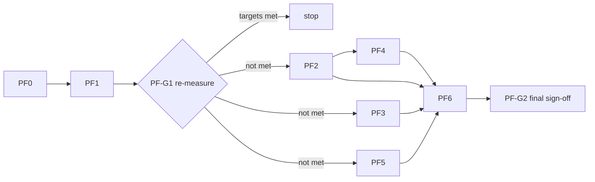

# Field Launcher: Performance Plan

The launcher feels sluggish on the Hisense TV. This plan turns the findings from a code read
(commit `9f5b843`) into ordered, individually shippable work items, each with an exact acceptance
check and a rollback.

- Rules and file ownership: [`CLAUDE.md`](../CLAUDE.md). **If this plan and `CLAUDE.md` disagree, `CLAUDE.md` wins.**
- Task briefs, handoff reports, gates and checkers work as in [`BUILD_PLAN.md`](BUILD_PLAN.md) §7.
- **Nothing here has been measured yet.** The cloud environment can't build or run the app. Every
  cause below is a hypothesis from reading the code until PF0 produces numbers on the TV.

---

## Building in the cloud

When `dl.google.com` is reachable, the cloud session can compile, run JVM unit tests and build the
release variant with R8. It cannot run the app (no emulator without KVM), so everything on-device stays
an owner check. Setup used so far (SDK kept outside the repo; accepting the SDK licenses is part of it):

```bash
SDK=<a scratch dir>/android-sdk && mkdir -p $SDK/cmdline-tools
curl -o tools.zip https://dl.google.com/android/repository/commandlinetools-linux-11076708_latest.zip
unzip tools.zip -d $SDK/cmdline-tools && mv $SDK/cmdline-tools/cmdline-tools $SDK/cmdline-tools/latest
yes | $SDK/cmdline-tools/latest/bin/sdkmanager --sdk_root=$SDK --licenses
$SDK/cmdline-tools/latest/bin/sdkmanager --sdk_root=$SDK "platforms;android-34" "build-tools;34.0.0" "platform-tools"
export ANDROID_HOME=$SDK
./gradlew :app:testDebugUnitTest :app:assembleRelease
```

`repo.maven.apache.org` can answer Gradle's parallel downloads with HTTP 429. Single requests succeed,
so this is rate limiting, not a block. A user-level init script (`~/.gradle/init.d/*.init.gradle.kts`, not
part of the project) that tries Google's Maven Central mirror first fixes it:

```kotlin
val mirror = "https://maven-central.storage-download.googleapis.com/maven2/"
beforeSettings {
    pluginManagement.repositories { maven { url = uri(mirror) } }
    dependencyResolutionManagement.repositories { maven { url = uri(mirror) } }
}
```

The Robolectric harness used for PF3 and PF4 verification (native graphics, a fake PackageManager, the
old and new modifiers side by side) is not in the repo. It needs `org.robolectric:robolectric`,
`androidx.compose.ui:ui-test-junit4` and `ui-test-manifest` as test dependencies,
`isIncludeAndroidResources = true`, and the system properties `robolectric.pixelCopyRenderMode=hardware`
and (to avoid Maven Central rate limits) `robolectric.dependency.repo.url` pointing at the mirror above.
Compose's `captureToImage` does not work under Robolectric's paused looper; capture with
`PixelCopy.request(activity.window, …)` after `waitForIdle()` and `shadowOf(mainLooper).idleFor(…)`, and put
Compose in keyboard input mode through `LocalInputModeManager` before requesting focus.

---

## 1. Approach

1. Measure first (PF0). Decide from numbers, not from this document.
2. Fix the cheapest, broadest thing first (PF1: release build). It may remove most of the lag by itself.
3. **Stop rule:** after PF1, re-measure against the targets in §3. If they are met, defer PF2 to PF6
   and keep this plan for later. Do not optimize past the target.
4. One change per branch, re-measured on its own, so a regression has one suspect.
5. Every change keeps the design rules: same focus look, same sound, same layout. Performance work
   must be visually and audibly indistinguishable except for being faster.

## 2. Work items

| ID | Item | Agent | Area (owner) | Depends on | Targets | Size |
|---|---|---|---|---|---|---|
| PF0 | Baseline measurements | owner | none | none | the numbers | S |
| PF1 | Release build, R8, ahead-of-time compile | integrator + worker | `app/build.gradle.kts`, `scripts/` | PF0 | everything (JIT warm-up, debug overhead) | S |
| PF2 | App list cache and event-driven reload | builder | `home/data/` (B), `MainActivity.kt` wiring (integrator) | PF0 | return-to-Home hitch, cold-start blank grid | M |
| PF3 | Focus animation off the composition phase | builder | `theme/Focus.kt` (integrator) | PF0 | D-pad smoothness | S to M |
| PF4 | Bitmap pipeline: right size, hardware bitmaps | builder (same branch as PF2) | `home/data/InstalledApps.kt` (B) | PF2 | drawer scroll, memory | S |
| PF5 | Sound: off the main thread, cached, cheaper DSP | worker (5a, 5b), builder (5c, 5d) | `sound/` (F) | PF0 | CPU contention at launch, tick cost | M |
| PF6 | Small items | integrator + worker | `HomeScreen.kt`, `Type.kt`, `DotGrid.kt`, `MainActivity.kt` (all integrator) | PF1 to PF5 results | minor | S each |



PF2+PF4, PF3 and PF5 touch disjoint areas and can run in parallel. The only shared file is
`MainActivity.kt`; agents list their changes under "Requested shared changes" and the integrator
applies them one at a time.

Branch names (multi-agent flow): `perf/PF1-release-build`, `perf/PF2-app-cache`,
`perf/PF3-focus-draw-phase`, `perf/PF5-sound-offload`, `perf/PF6-polish`. In a single-session run,
commit to the session branch in the same order, one commit per item.

## 3. Targets

Initial targets; adjust once PF0 shows where the device actually is. All measured on the **release**
build with the same app set and the same pinned apps.

| Metric | Target |
|---|---|
| Janky frames over 20 rapid D-pad moves (Home and drawer) | under 5% |
| 95th percentile frame time during those moves | at most 16 ms |
| Frames over 50 ms in the second after returning Home from an app | 0 |
| Cold start to a grid with artwork | under 1 s |
| OK press to start of the launch motif | under 60 ms |
| Slow bitmap uploads while scrolling the full drawer | 0 or near 0 |

---

## PF0: Baseline (owner)

Goal: numbers for debug, for release, and (later) after each item.

**Setup.** Same pinned apps and same installed set every run. Debug and release share an
applicationId and signing key, so one installs over the other without uninstalling.

```bash
./gradlew installDebug      # run set D
./gradlew installRelease    # run set R (release is signed with the debug key already)
PKG=com.andrewevmiller.tvlauncher
```

**1. Focus and scroll smoothness** (Home, then the all-apps drawer)
```bash
adb shell dumpsys gfxinfo $PKG reset
adb shell "input keyevent 22 22 22 22 22 22 22 22 21 21 21 21 21 21 21 21"   # right x8, left x8, back to back
adb shell "input keyevent 20 20 20 20 20 20 19 19 19 19 19 19"                # down x6, up x6
adb shell dumpsys gfxinfo $PKG
```
Record: total frames, janky frames and percent, 50th/90th/95th/99th percentile, slow UI thread,
**slow bitmap uploads**, slow issue draw commands. Repeat inside the drawer (OK on the All apps tile first).
Sending the keys in one call approximates a held D-pad, which is the harsh case.

**2. Cold start**
```bash
adb shell am force-stop $PKG
adb shell am start -W -n $PKG/.MainActivity     # record TotalTime
```
Also note by eye how long until the grid shows banners and icons.

**3. Return to Home after launching an app**
```bash
adb shell dumpsys gfxinfo $PKG reset
# launch any tile with OK (keyevent 23), wait 3 s, then:
adb shell input keyevent 3                       # HOME
sleep 2; adb shell dumpsys gfxinfo $PKG          # janky burst right after HOME?
```

**4. System trace** (one trace of step 3, one of a held D-pad run)
```bash
adb shell perfetto -o /data/misc/perfetto-traces/pf0.pftrace -t 15s -a $PKG \
  sched freq idle am wm gfx view binder_driver input
adb pull /data/misc/perfetto-traces/pf0.pftrace
```
Open in https://ui.perfetto.dev. Look for: long slices on the main thread (font loading, `FieldSound`,
bitmap work), the loader thread competing with RenderThread after HOME, and `Choreographer#doFrame`
slices over 16 ms.

**5. Memory with the drawer fully loaded**
```bash
adb shell dumpsys meminfo $PKG        # Java Heap, Graphics, Total PSS
adb shell "ls /proc/$(pidof $PKG)/fd | wc -l"      # open file descriptors (matters for PF4)
```

**6. Recomposition counts** (debug build only): Android Studio Layout Inspector, recomposition counts
on, move focus across tiles. Note how many times `AppTile` recomposes per focus move (PF3 baseline).

**Deliverable:** fill the results log (§5) column "Debug" and "Release (JIT)".

---

## PF1: Release build, R8, ahead-of-time compile

**Why.** The documented verify loop is `installDebug`. Compose in a debug build has no R8 and is
mostly interpreted or JIT-compiled until it warms up, and a launcher process is often cold. Release
builds also merge the Compose libraries' own baseline profiles.

**Status:** implemented. `assembleRelease` with R8 and resource shrinking builds cleanly on current `main`
(no missing-class warnings; `mapping.txt` produced; Compose's baseline profiles merged by
`compileReleaseArtProfile`). Not yet run on the TV: the smoke test and the numbers under Acceptance are
still the owner's. `deploy.sh` does not exist on `main`, so its half of step 3 is open.

**Files:** `app/build.gradle.kts` (integrator), new `app/proguard-rules.pro` (integrator),
`scripts/deploy.sh` (agent A; `scripts/` is not in this checkout yet, so until it lands put the
commands in the README install section).

**Steps**
1. In `release { }` set:
   ```kotlin
   isMinifyEnabled = true
   isShrinkResources = true
   proguardFiles(getDefaultProguardFile("proguard-android-optimize.txt"), "proguard-rules.pro")
   ```
   Keep the existing debug signing config.
2. Add `app/proguard-rules.pro` containing only a comment. Nothing in the app is reflective, and the
   Compose and tv-material artifacts ship their own consumer rules. Add rules only if a release
   smoke test crashes, and say why in the file.
3. `deploy.sh` installs the release variant by default (`--debug` flag keeps the old path) and then runs:
   ```bash
   adb shell cmd package compile -f -m speed com.andrewevmiller.tvlauncher
   ```
   Reinstalling resets compilation, so this must run after every install.
4. No new dependencies. `profileinstaller` already arrives transitively through Compose.

**Acceptance**
- `adb shell dumpsys package $PKG | grep -i status=` shows `status=speed` after deploy.
- Release smoke test on the TV: Home renders, fonts load, a tile launches an app, an HDMI tile opens
  its input, Back leaves the drawer. `mapping.txt` exists under `app/build/outputs/mapping/release/`.
- PF0 set R+ recorded. **PF-G1:** compare with the §3 targets. If met, stop here.

**Rollback:** revert the three `release` lines; `installDebug` still works.

**Follow-up (not in scope):** an app-specific baseline profile via Macrobenchmark. Needs a device
workflow; revisit only if `speed` compile alone is not enough.

---

## PF2: App list cache and event-driven reload

**Why.** `MainActivity.onResume` ran `thread { apps = InstalledApps.load(this) }` every time the
launcher resumed. Each run queried the package manager twice, loaded every label, banner and icon from
other APKs, and rasterized each into a fresh bitmap. The thread had default priority and nothing
cancelled overlapping runs. The new bitmaps were different objects, so every tile recomposed and
re-uploaded its texture just as the user landed on Home. On cold start the grid was empty until the
whole scan finished.

**Status:** implemented and building (debug unit tests and release/R8). The loader has also been run end
to end against a fake PackageManager in a Robolectric harness (see PF4, "Also verified"). Not yet run on
the TV; see Acceptance.

**Files:** new `home/data/AppLoader.kt` (Android side), `AppStamps.kt` and `AppSnapshot.kt` (pure
logic), `InstalledApps.kt` (`load()` removed; `toBitmap` and `categoryOf` now `internal` and shared),
`MainActivity.kt` (wiring: create the loader, `refresh()` in `onResume`, `close()` in `onDestroy`).
Tests: `AppStampsTest`, `SnapshotCodecTest` (29 cases).

**Design (as built)**
- **Stamp check instead of a scan.** One `getInstalledPackages(0)` call gives each package's
  `lastUpdateTime` and enabled state. `AppStamps.signature` digests them (sorted, plus the locale, since
  labels depend on it). If the digest matches the last scan and the scan is under 12 hours old
  (`MAX_AGE_MS`, a safety net for launcher aliases toggled inside an app), nothing else runs.
  No broadcast receiver, so nothing is missed when the Activity is destroyed.
- **Incremental rescan.** When the digest differs, `queryIntentActivities` still runs, but an app whose
  package, activity, pinned flag and `lastUpdateTime` all match the previous entry keeps its existing
  `LauncherApp` instance. Only new or updated apps load a label and artwork. Unchanged tiles are
  therefore equal to before and Compose skips them. An unknown update time (0) is never reused.
- **Snapshot.** `filesDir/apps.snapshot` (binary, versioned; anything unreadable counts as no snapshot,
  written via a temp file and rename) holds label, component, category, pinned flag, art kind and
  update time per app. Artwork lives in `cacheDir/art/<package>-<lastUpdateTime>.png`. Files for old
  builds, uninstalled apps and leftover temp files are deleted after each rescan.
- **Cold start.** The loader publishes the snapshot immediately with artwork decoded for leanback
  (Home) apps, then publishes again once the rest of the artwork is decoded. If the system purged the
  cache directory, missing artwork is re-rendered from the package and cached again (`fillMissingArt`
  runs on every refresh, so an interrupted decode also finishes later).
- **Threading.** One background-priority thread. A newer `refresh()` makes an older run in flight stop
  early (generation counter checked between apps), so quick back-to-back resumes do one scan.
  `publish` is called on the main thread. Scan, restore, persist and art phases have
  `Trace` sections for Perfetto, and Logcat tag `AppLoader` reports what happened.

**Not done here (left for later items)**
- Icon size and hardware bitmaps: PF4 (done; see below).
- The in-memory cache does not survive the Activity being destroyed while the process lives; the
  snapshot covers that case at the cost of one more restore.

**Acceptance**
- JVM unit tests: signature is order-independent and changes with any stamp or the locale; rescan
  rule (no earlier scan, changed digest, too old, clock moved back); reuse rule; snapshot round trip
  including awkward labels; truncated, wrong-version and absurd-count snapshots decode to null;
  stale-art selection. **Done: 29 pass.** They already caught a decoder bug (reading a field inside a
  lookup lambda), which is now fixed.
- Device: return Home with no package changes. Logcat (`adb logcat -s AppLoader`) shows
  `scan skipped: N apps unchanged`, no publish, and gfxinfo shows no jank burst in the next second
  (PF0 step 3).
- Device: `adb shell pm disable-user --user 0 <an app you don't mind toggling>`, return Home: the tile is
  gone, log shows `scan: reused N-1, rebuilt 0`. `pm enable` brings it back with `rebuilt 1`.
- Device: `am force-stop`, then `am start -W`. Log shows `restored N apps from snapshot`, and the
  grid has banners before the reconcile finishes (compare with PF0 step 2).
- Device: change the system language, return Home: labels update (digest includes the locale).
- Two quick resumes in a row produce one scan, not two overlapping ones.

**Rollback:** `git revert` of the PF2 commit restores the old `thread { load }` path.

---

## PF3: Focus animation off the composition phase

**Why.** `fieldFocus` read the animated value `t` in the composition body, in the
`border(width = lerp(…t), color = lerp(…t))` arguments. Every frame of the 160 ms tween then
recomposed the host tile (`AppTile`, `ChipPill`, …), for the tile losing focus and the one gaining it.
Only the `graphicsLayer {}` block read `t` in the right phase.

**Status:** implemented, building, and verified in a Robolectric harness (below). Not yet run on the TV.

**Files:** `theme/Focus.kt` (integrator), new `FocusMathTest`. Public signatures of `fieldFocus` and
`fieldTile` are unchanged, including `bleed`.

**Design (as built)**
- Progress is an `Animatable`, started from `onFocusChanged` in a `rememberCoroutineScope` (reduced
  motion uses `snap()`, else a 160 ms `tween`, as before). The focused flag is a plain holder, not state,
  so a focus change reads nothing in composition and recomposes nothing.
- Progress is read only inside `graphicsLayer {}` (scale, tilt) and a `drawWithCache` block that draws
  the border after the content. The outline is cached per size.
- `drawFieldBorder` reproduces `Modifier.border` as foundation 1.7.3 implements it: stroke rounded up to
  whole pixels and capped at half the smaller side, inset by half the stroke, corner radius shrunk by
  half the stroke, a fill when the stroke is thicker than the tile, and a clip-and-stroke fallback for
  shapes `border` would build a path for. The width, color and endpoint rules (`bleed` starts at 0.5dp
  and transparent) live in small `internal` functions with unit tests.
- Unchanged: tick sound on focus gain, scale 1.06, tilt straightening, border above the content and
  outside the tile's `clip`, `fieldTile` still adds the click handler.

**Verified (scratch Robolectric harness, native graphics; the old modifier kept beside the new one)**
- **Recomposition.** Over four focus moves with the app's tile structure, the old modifier recomposed
  its host tile **44 times** (11 per animation, in and out). The new one: **0**.
- **Pixels.** Normal and full-bleed tiles at rest and after settling are identical (0 px; 1 px off by one
  level when focused). Through the animation the new tile shows what the old one showed one frame
  later: the old version only starts after a recomposition, so the new one begins a frame (about 16 ms)
  sooner. With that frame aligned, **14 to 19 pixels differ out of about 1.6 million compared, by at
  most 2 levels of 255**, in both directions.
- The harness is not in the repo because it needs Robolectric and Compose UI-test dependencies
  (`org.robolectric:robolectric`, `androidx.compose.ui:ui-test-junit4`, `ui-test-manifest`) plus
  `robolectric.pixelCopyRenderMode=hardware`. It can be added as a test if wanted.

**Still open**
- Both modifiers still use `composed`, which costs a little when a tile first enters composition (the
  drawer, while scrolling). Converting to `Modifier.Node` is worth doing only if the post-PF2 traces
  show tile composition on the main thread during scrolling.
- `fieldTile` could drop its own `composed` by passing no interaction source to `clickable`; skipped here
  to keep this change to the animation.

**Acceptance**
- JVM unit tests: endpoints and midpoints of scale, tilt, width and color (normal and `bleed`), and the
  stroke rule. **Done: 8 new, all pass.**
- Recomposition and pixel parity: **done in the harness above.**
- Device: gfxinfo on Home and the drawer (PF0 step 1) is no worse and ideally better, and focus moves
  look the same. Layout Inspector (debug build) recomposition counts on a focus move should now be 0.
- Design checker C-X1: no hex literals, accent only on the focused element, only `fieldFocus`/`fieldTile`.

**Rollback:** `git revert` of the PF3 commit.

---

## PF4: Bitmap pipeline (ships with PF2)

**Why.** Icons were rasterized at 192×192 (about 144 KB each) but drawn at 44dp, which is 88 px at
density 320: roughly 4.7× too many pixels, scaled down without mipmaps. Software bitmaps are also
uploaded to the GPU on the first frame that draws them, on the render thread, which is when scrolling
the drawer stutters. Banners at 384×216 were already the right size.

**Status:** implemented, building, and the surrounding loader verified in a Robolectric harness. The
hardware-bitmap step itself is **not** verified: Robolectric has no hardware bitmaps, so it needs the
TV (see Acceptance).

**Files:** `home/data/AppLoader.kt`, `InstalledApps.kt`, `AppSnapshot.kt` (new `ArtLimits`), new
`ArtLimitsTest`.

**Design (as built)**
- **Sizes.** `ArtLimits`: banner 384×216 (exactly a 192×108dp tile at 2 px per dp), icon 96×96 (the 44dp
  icon is 88 px; 96 covers the 1.06 focus scale). A test ties these to `FieldDimens` and the icon size so
  a layout change can't silently leave art blurry or oversized. Per icon: 36,864 bytes, down from 147,456.
- **Rendering.** Rasterize to a software bitmap, write the PNG from it, then copy into a hardware bitmap
  and recycle the software one. The PNG is written first because a hardware bitmap can't be compressed.
  Pixels now reach the GPU on the loader thread, not on the first frame that draws them.
- **Decoding the cache.** `inPreferredConfig = HARDWARE` decodes straight into GPU memory, so a cold start
  never holds a heap copy of the artwork. Falls back to a software decode and copy.
- **Only real hardware bitmaps count.** If a copy comes back as an ordinary bitmap, it is discarded and
  the original is kept (no duplicate in the heap), and it does not count against the cap.
- **Descriptor guard.** `MAX_HARDWARE = 300` bitmaps on the GPU; past that, software bitmaps. The 300 is a
  conservative guess, not a measured limit. After each load that changed anything, `adb logcat -s AppLoader`
  prints `art: N on the GPU, M in heap (K KB), F open file descriptors`, so it can be tuned from real numbers.
- **Cache migration.** `SnapshotCodec.VERSION` is now 2, so the first launch after this change ignores the
  old snapshot, rescans, and overwrites the 192 px files with 96 px ones.

**Also verified (same harness as PF3, driving the real `AppLoader` against a fake PackageManager;
covers PF2 too, which had only been compiled before)**
- First launch scans everything: apps sorted by label, pinned flag from the leanback entry, icons 96×96,
  one PNG each, snapshot written.
- A resume with nothing changed: no scan, no publish.
- An app installed or updated: exactly one app rebuilt; the others are the very same instances (so
  Compose skips their tiles); the old cache file is deleted. An app removed: gone.
- A new loader after "process death": the first publish comes from the snapshot with Home's apps already
  carrying artwork; no rescan; the rest of the artwork fills in.
- Cache directory purged: artwork is re-rendered from the packages and cached again.

**Acceptance**
- JVM unit tests: raster sizes match the tile and icon sizes; the cap rule; version 1 snapshots are
  ignored. **Done: 4 new, all pass (41 total).**
- Loader behavior: **done in the harness above.**
- Device: after a cold start and after opening the drawer, `adb logcat -s AppLoader` should show
  `art: N on the GPU` with N equal to the number of apps that have artwork (0 means the hardware copy
  isn't happening on this TV), and a file-descriptor count that is far from the process limit
  (`adb shell cat /proc/$(pidof com.andrewevmiller.tvlauncher)/limits | grep "open files"`).
- Device: gfxinfo while scrolling the full drawer: "Number Slow bitmap uploads" drops to 0 or near 0
  (PF0 step 1). `dumpsys meminfo`: Java heap and graphics compared with PF0 step 5.
- Visual: icons look the same on Home, in the drawer and in the Recent row; no shimmer or blur.

**Rollback:** `git revert` of the PF4 commit; the snapshot version bump makes the cache rebuild either way.

---

## PF5: Sound

All of this stays inside `sound/` (agent F). The motif generator (FNV-1a, mulberry32, draw order,
scale, timing) is **not touched**, so the auditioned motifs do not change.

### 5a. Tick path and policy (worker)

**Why.** `tick()` runs on the main thread inside `onFocusChanged`. It reads
`Settings.System.getInt` and calls `SoundPool.play` in the same frame as the focus change
(`Focus.kt:46-48`, `FieldSound.kt:66-96`). The guard at `FieldSound.kt:74` can never fire because
`lastTick = now` runs on the line before it, so held-key repeats are never throttled.

**Steps**
1. Extract the throttle into a small pure class and fix the semantics: the existing `< 90 ms` rule
   chooses `tick_held`; add a hard floor (skip when under about 35 ms since the last tick, which also
   absorbs duplicate callbacks).
2. Cache `allowed()` in a `@Volatile` field kept current by a `ContentObserver` on
   `Settings.System.getUriFor(SOUND_EFFECTS_ENABLED)`; register in `init`, unregister in `release()`.
3. Post `pool.play` to a single-thread playback executor so the UI thread only enqueues.
4. `Trace.beginSection("FieldSound.tick")` around the enqueue.

**Acceptance:** JVM unit tests for the throttle (floor, held threshold, first tick). Perfetto: the
`FieldSound.tick` slice on the main thread is under 1 ms.

### 5b. Cache the fixed sound set (worker)

**Why.** `renderFixedSet` re-renders and rewrites five WAVs on every Activity creation, on a
normal-priority thread, during first composition (`FieldSound.kt:55-58`, `118-143`).

**Steps**
1. Name files `fs_<name>_<waveform>_v<RENDER_VERSION>.wav`. Bump `RENDER_VERSION` whenever DSP changes.
2. If the file exists, load it into `SoundPool` and skip rendering; otherwise render, write, load.
3. Delete cached files for other waveforms or older versions.
4. Run rendering on a background-priority executor, separate from the playback executor in 5a.

**Acceptance:** unit test for file naming and stale cleanup. Device: second launch of the app renders
nothing (logcat), ticks still play on the first focus move.

### 5c. Cheaper DSP (builder)

**Why.** The inner sample loop in `render` calls `pow`, `sin`, `cos` for values that do not change per
sample: the detune ratio (`FieldSound.kt:251`), `qLin` (`262`), the filter coefficients (`263-267`), the
envelope (`268-269`) and the click-filter coefficients (`273-277`). A 4-note motif is roughly 40,000
voice-samples at up to ten transcendental calls each. This runs on the worker at the exact moment an app is
starting, delaying the sound and taking CPU from the app.

**Steps**
1. **Parity harness first.** Make phases and noise deterministic by injecting a `Random` (tests only;
   production keeps `Math.random()`), and keep the current implementation as a test-only
   `renderReference`. Moving the pure DSP (`Voice`, `Biquad`, `render`) into `sound/synth/`, as
   BUILD_PLAN F2/F3 already plan, lets it run as a plain JVM test without the Android SDK.
2. Hoist per-voice constants: detune ratios, `qLin`, `norm`.
3. Update low-pass coefficients every 16 samples (about 0.3 ms at 48 kHz) instead of every sample. The
   cutoff sweep is smooth, so this is inaudible.
4. Replace per-sample envelope `pow` with a per-sample multiply by a precomputed ratio; handle the
   attack-to-decay switch at 3 ms explicitly.
5. Hoist the noise-click coefficients and decay.
6. Replace `% 1.0` on phases with a compare-and-subtract.

**Acceptance**
- Parity test: for every category timbre and every waveform, `max |new − reference|` is under 1e-3 of
  full scale (tighten if it passes easily) with the same seed.
- Device: logged `render` time for a motif drops by at least 5× (log with `System.nanoTime`, compare debug
  and release). A/B listening against the previous APK for a few apps and all waveforms; no audible change.
- Checker C-X3: generator signatures untouched.

### 5d. Pre-render motifs (builder; aligns with BUILD_PLAN F4/F5)

**Why.** Even a cheaper render is work at the worst time. Render ahead of time instead.

**Steps**
1. After the app list settles (PF2), render motifs for pinned apps one at a time on the background
   executor, yielding between apps. Cache PCM in an `LruCache` keyed
   `(package, rerollCount, waveform, RENDER_VERSION)`. Humanize is **not** part of the key.
2. `launch(app)`: on a cache hit, play immediately; on a miss, render, play, and cache.
3. Apply humanize at playback: ±5 cents as `PlaybackParams.setPitch(2^(cents/1200))`, ±10% level as
   track volume. This matches BUILD_PLAN §8.2 ("applied as playback rate on the pre-rendered buffer").
4. Re-render and clear the cache when the waveform setting changes (already required by `CLAUDE.md`).
5. Stretch: one long-lived streaming low-latency `AudioTrack` instead of a new static track per launch
   (BUILD_PLAN F5). Only if track creation shows up in the trace.

**Acceptance:** cache hit/miss unit tests (key includes waveform and reroll, excludes humanize). Device:
OK press to audible launch motif under 60 ms for a pre-rendered app (log from `launch()` entry to
`track.play()`, then confirm by ear); no pop or click at the start; Perfetto shows no render slice
overlapping an app launch.

**Rollback (all of PF5):** each sub-item is its own commit.

---

## PF6: Small items

Do these only if the PF0 and post-PF5 traces show them mattering. Each is independent.

| ID | Change | Where | Do it when | Acceptance |
|---|---|---|---|---|
| 6a | Wrap the derived `apps`, `cells`, `gridRows` in `remember(allApps, chip, drawer)` | `HomeScreen.kt:73-77` | always (trivial) | Layout Inspector: `HomeScreen` body does not rerun on focus moves |
| 6b | Preload fonts off the main thread at startup: `createFontFamilyResolver(context).preload(...)` for the four families, launched before `setContent` | `MainActivity.kt` | the trace shows font loading on the main thread during first composition | no font-load slice on the main thread in the first-composition trace |
| 6c | Render the dot grid as one tiled `ImageShader` fill instead of about 780 round points; fall back to the current path when the cell size in px is not an integer | `theme/DotGrid.kt` | the draw slice is over 1 ms per frame while scrolling | pixel-identical screenshot; slice time drops |
| 6d | Clear the window background after the first frame (`window.setBackgroundDrawable(null)`), since the root `Box` already paints `bg` | `MainActivity.kt` | overdraw check shows two full-screen fills | `adb shell setprop debug.hwui.overdraw show`; no cold-start flash |
| 6e | Move the inline `Field.type.x.copy(fontSize = …)` styles into named entries on `FieldType` (`tileTitle`, `tileCaption`, `sectionLabel`, `chip`) | `theme/Type.kt`, `HomeScreen.kt`, `ClockHeader.kt` | after PF3; also tightens the "type only from `Field.type`" rule | identical rendering; no allocation in tile composables |
| 6f | StrictMode in debuggable builds: thread policy for disk and network on the main thread, `penaltyLog()` only. Check `applicationInfo.flags and FLAG_DEBUGGABLE`; AGP 8 does not generate `BuildConfig` by default | `MainActivity.kt` | always (debug only) | no `StrictMode` violations in logcat during Home, drawer and launch |

---

## 4. Process per item

1. Integrator writes the brief (BUILD_PLAN §7.3 format), including the files in scope, the PF0 numbers
   to beat, and the acceptance block above.
2. The agent works in its own area, runs the JVM tests it can, and files the handoff report. Shared
   file changes go under "Requested shared changes".
3. Checkers C-X1, C-X2 and C-X3 run on the branch before merge. For PF3 and PF6e, C-X1 is the main one.
4. The integrator merges one item at a time and the owner deploys the **release** build and re-runs only
   the affected PF0 steps.
5. Results go in the log below. An item that does not move its metric is dropped, not kept for tidiness.

Gate summary: **PF-G1** after PF1 (stop rule). **PF-G2** after the last merged item: the full PF0 set
plus the `BUILD_PLAN.md` §10 checklist items for focus, launch, drawer, sound and rescue.

## 5. Results log

Fill in as items land. "n/a" means not measured at that stage.

| Metric | Debug | Release (JIT) | After PF1 | After PF2+4 | After PF3 | After PF5 | Final |
|---|---|---|---|---|---|---|---|
| Janky frames, Home (%) | | | | | | | |
| 95th percentile frame (ms), Home | | | | | | | |
| Janky frames, drawer (%) | | | | | | | |
| Slow bitmap uploads, drawer | | | | | | | |
| Cold start `TotalTime` (ms) | | | | | | | |
| Janky frames in the second after HOME | | | | | | | |
| Launch motif latency (ms) | | | | | | | |
| `AppTile` recompositions per focus move | | | | | | | |
| Java heap / Graphics (MB) | | | | | | | |
| Open file descriptors, drawer loaded | | | | | | | |

## 6. Risks

| Risk | Mitigation |
|---|---|
| R8 strips something needed at runtime | Release smoke test in PF1; add a keep rule only for a proven crash, with a comment |
| `compile -m speed` is lost on reinstall | Run it from `deploy.sh` after every install |
| Stale app list if the signature misses a change (for example a single component disabled inside an app) | Signature covers package update time and enabled state; add a manual "Rescan apps" item in Settings later |
| Hardware bitmaps exhaust file descriptors | Descriptor count in PF0 and PF4; hardware only for pinned apps if needed |
| DSP optimization changes the sound | Parity test plus A/B listening; generator code untouched; bump `RENDER_VERSION` so caches rebuild |
| Focus restyle drifts from the design | Screenshot parity and checker C-X1; `fieldFocus`/`fieldTile` signatures unchanged |
| Cloud environment can't run the app | It can compile, run JVM unit tests and build release/R8 when `dl.google.com` is reachable (see Building in the cloud), but there is no emulator (no KVM). Device behavior is always an owner check; keep each commit small |

## 7. Out of scope

- Oxyfield screensaver performance (agent D; not in this checkout yet).
- An app-specific baseline profile and a Macrobenchmark module.
- Gradle build-time speedups (configuration cache, build cache).
- Any change to visuals, copy, sound character or the product decisions in `CLAUDE.md`.
